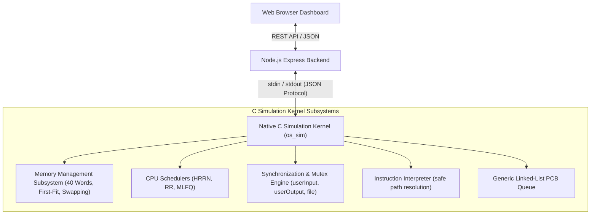

# System Architecture & Design Specification

## 1. High-Level Architecture Overview

The Operating System Simulation Engine is engineered as a decoupled, dual-tier system composed of a high-performance native C simulation kernel and a reactive Node.js/Web frontend. The native C engine serves as the **single source of truth** for all operating system mechanics—no scheduling, memory allocation, or synchronization logic is duplicated in higher layers.



---

## 2. Subsystem Breakdown

### 2.1 Process Management & PCB (`src/process/`, `include/os_shared.h`)
Each process is represented by a Process Control Block (`PCB`):
- **Metadata**: Process ID (`pid`), Arrival Time (`arrival_time`), Priority Level (`priority_level`, `0..3` for MLFQ).
- **Execution State**: Program Counter (`program_counter`), Total Instructions (`num_instructions`), Execution State (`NEW`, `READY`, `RUNNING`, `BLOCKED`, `FINISHED`).
- **Memory Tracking**: Memory start index (`mem_start`), Memory end index (`mem_end`), Swap backup pointer (`swap_data`) preserving variables during eviction.
- **Metrics**: `waiting_time`, `remaining_time`, `response_time`, `turnaround_time`, `completion_time`, `first_dispatched`.
- **Instruction Storage**: Dynamic array of instruction strings (`char instructions[MAX_INSTRUCTIONS][MAX_LINE_LEN]`).

### 2.2 Memory Management Subsystem (`src/memory/`)
The physical RAM consists of 40 contiguous simulated words (`MemoryWord memory[40]`):
- **Word Structure**: `{ char name[MAX_VAR_NAME]; char value[MAX_VAR_VALUE]; }`.
- **First-Fit Contiguous Allocation**: Allocates contiguous slots for:
  - 8 PCB metadata words (`pc`, `state`, `pid`, `priority`, etc.).
  - 3 variable words (`var1`, `var2`, `var3`).
  - $N$ instruction words ($N = \text{instruction\_count}$).
  - Total requirement: $8 + 3 + N$ words.
- **Swap Manager**: When allocation fails due to memory fragmentation or capacity:
  - A victim process is selected (lowest priority, longest idle/blocked, or highest memory).
  - Variables and state are serialized into `p->swap_data`.
  - The victim's words are zeroed and released.
  - Upon being rescheduled, `swap_in()` allocates a new contiguous block via first-fit and re-hydrates all saved variables and PCB words.

### 2.3 CPU Schedulers (`src/scheduler/`)
The kernel implements three distinct CPU scheduling algorithms selectable via CLI or JSON payload:

1. **HRRN (Highest Response Ratio Next)**:
   - Strict **non-preemptive** scheduling.
   - Response ratio formula:
     $$R = \frac{W + S}{S}$$
     where $W$ is the total waiting time and $S$ is the remaining service time.
   - The ready process with the maximum ratio is scheduled and runs **to completion or until blocking on a mutex**.
   - Quantum is dynamically set to `running->num_instructions - running->program_counter`.
   - Deterministic tie-breaking prefers lower PID.

2. **Round Robin (RR)**:
   - Preemptive time-sliced scheduling with configurable quantum $Q$ (default: 2).
   - Once a process executes for $Q$ ticks without finishing or blocking, it is demoted to the tail of the ready queue.

3. **Multi-Level Feedback Queue (MLFQ)**:
   - 4 discrete priority queues ($Q_0, Q_1, Q_2, Q_3$).
   - Quantum for queue $i$:
     $$Q_i = 2^i \quad (Q_0=1, Q_1=2, Q_2=4, Q_3=8)$$
   - Newly arrived or unblocked processes enter $Q_0$.
   - A process exhausting its quantum at priority $i$ is demoted to $Q_{i+1}$ (capped at $Q_3$).
   - Strict priority preemptive scheduling: higher queues always preempt lower queues.

### 2.4 Synchronization & Mutexes (`src/synchronization/`)
Three hardware/OS resources are managed:
- `userInput`: guards terminal and keyboard reads.
- `userOutput`: guards standard console print operations.
- `file`: guards disk file reads and writes.

Each mutex maintains:
- Binary lock flag (`locked`).
- Owner process (`owner_pid`).
- Waiting queue (`Queue* wait_queue`).
- System calls: `sim_sem_wait(mutex, p, ready_queue)` and `sim_sem_signal(mutex, p, ready_queue)`. When released, the mutex is handed directly to the head of the wait queue, unblocking the process and moving it back to the ready queue.

### 2.5 Instruction Interpreter (`src/interpreter/`)
The interpreter executes one instruction per CPU tick:
- `semWait <resource>`: locks or blocks on `userInput`, `userOutput`, or `file`.
- `semSignal <resource>`: releases and unblocks waiting processes.
- `assign <var> <val>`: literal assignment.
- `assign <var> input`: prompts user/inputMap for input and stores it.
- `assign <var> readFile <filename>`: reads file contents into variable.
- `writeFile <filename> <data>`: writes variable or literal into disk file within sandbox.
- `print <var>`: outputs variable value.
- `printFromTo <a> <b>`: prints consecutive integer range.

---

## 3. Communication Protocol (C CLI / Node.js Backend)

The C engine accepts a `--json` parameter and reads the simulation configuration from standard input (`stdin`), outputting an exhaustive simulation trace to standard output (`stdout`):

```json
{
  "scheduler": "RR",
  "rrQuantum": 2,
  "programs": "programs",
  "sandbox": "sandbox",
  "processes": [
    { "pid": 1, "file": "Program 1.txt", "arrival": 0, "inputMap": { "x": "2", "y": "7" } }
  ]
}
```

The output JSON structure provides:
- `summary`: total execution steps, final time, outputs count, error count.
- `metrics`: average waiting time, average turnaround time, average response time, CPU utilization, throughput, context switch count.
- `processes`: array of final process metrics and completion statuses.
- `timeline`: array of chronological events (`PROCESS_DISPATCHED`, `MEMORY_ALLOCATED`, etc.).
- `snapshots`: step-by-step state captures including the 40-word memory grid, ready/MLFQ/blocked queues, mutex owners, and CPU dispatch.

